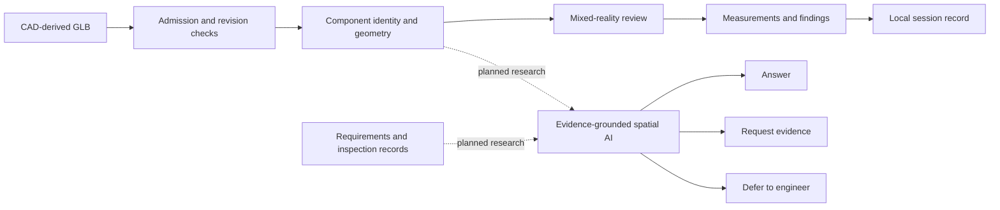

# Assembly Lens Research Evidence

Assembly Lens is a local-first mixed-reality engineering review system for Meta Quest 3. It loads CAD-derived GLB assemblies and keeps model geometry, stable component identity, measurements, findings, visibility state, model manipulation, undo history, and saved review sessions connected inside a passthrough workspace.

This repository contains a concise technical case study and selected evidence supporting the project description in Ajay Valeti's ETH AI Center Doctoral Fellowship application. It is an evidence repository, not the Assembly Lens production source repository.

## Research direction

The proposed research asks how a spatial AI assistant can combine CAD structure, geometry-derived measurements, engineering requirements, inspection evidence, and review history while preserving expert responsibility. The intended system should be able to:

- answer when the available evidence supports a recommendation;
- request a specific missing record when the evidence is incomplete;
- defer to a qualified engineer when uncertainty or conflicting evidence makes an answer unsafe;
- link every output to the affected component and its supporting evidence; and
- operate locally where proprietary manufacturing data cannot be sent to an external service.

This is a research direction and evaluation plan. This repository does not claim completed multimodal-AI study results.

## Current system

The implemented Assembly Lens prototype provides:

- guarded runtime loading of CAD-derived GLB models;
- stable part identity and synchronized 3D, hierarchy, and contextual selection;
- measurements, surface findings, visibility controls, and exploded views;
- direct controller-based model manipulation and chronological undo;
- local review persistence bound to an exact model revision; and
- layered verification that separates source, Unity Editor, simulator, and physical-device evidence.

## System and evidence flow

## Grey-view root-cause investigation

A physical Quest 3 test produced an intermittent flat-grey view while the application remained responsive and compositor-layer panels stayed visible. The investigation used controlled interventions rather than relying on appearance alone:

1. Hiding 4,685 model renderers did not remove the failure.
2. Disabling 4,686 model colliders prevented the failure during repeated approaches.
3. Restoring the colliders restored the failure.
4. Source inspection identified a model-root bounds trigger on a layer monitored by Meta's wall-penetration comfort system.
5. Moving that trigger to the `ModelParts` layer removed the false interaction at the previously reproducible locations in the reported fixed-build test.

The case study records the mechanism, competing explanations, negative results, fix, and remaining verification limits.

## Technical report

- [Assembly Lens Technical Case Study](reports/Assembly_Lens_Technical_Case_Study.pdf)

## Evidence boundaries

- Physical Quest evidence applies to the tested build, headset, models, and locations described in the case study.
- Unity Editor and automated checks establish logic and source behavior; they do not establish passthrough quality, controller feel, stereo comfort, thermals, or headset performance.
- Proprietary CAD models, customer data, production source code, application binaries, and signing material are intentionally excluded.

## Citation

Valeti, Ajay. *Assembly Lens: Local-First Mixed-Reality Engineering Review on Meta Quest 3*. Technical case study, 2026.

## Author

**Ajay Valeti**  
Co-Founder and CTO, Assembly Lens  
[LinkedIn](https://www.linkedin.com/in/ajay-valeti-6a4850337)

## Rights

Copyright © 2026 Ajay Valeti. All rights reserved. The materials are made publicly available for application review and scholarly citation. No production source code or customer data is included.
